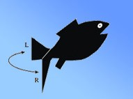
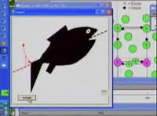

### Note from the ModelDB administrator: This below web page is a copy from the author's web site, [http://mdcune.psych.ucla.edu/modules/swimmy](http://mdcune.psych.ucla.edu/modules/swimmy), made on June 24th, 2009.
Please see [that site](http://mdcune.psych.ucla.edu/modules/swimmy) for proper style sheet version.

---

# SWIMMY

Free and complete software providing experience with neurophysiological phenomena and mechanisms of motor pattern generation in virtual neural circuits. Student manuals also provided.

### 

### About SWIMMY

**SWIMMY** is an instructional tool for teaching neurophysiology that requires only a computer.  **SWIMMY** is a virtual fish that swims, moving its virtual tail by means of a virtual neural circuit.  **SWIMMY** offers students the opportunity to approach a conceptually challenging task of scientific discovery and to get practical experience with the basics of neurophysiology--without the impediments of in vivo or in vitro neurophysiology experiments.  **SWIMMY** is available for free, along with student and instructor tutorials.

### Download SWIMMY Files

Students and Faculty can download the **SWIMMY Program** and **SWIMMY Tutorials** for free.

1. **Download the SWIMMY Program**:  In order to download the [**SWIMMY Program ("SwimmyGUI")**](http://mdcune.psych.ucla.edu/modules/swimmy/download-swimmy/user-consent-form), you must first fill out the **User Consent/Download Questionnaire** (after which you will be directed to the download button).  Note that you will still be allowed to download **SWIMMY** even if you choose NOT to consent to anything.

2. **Take the Student Pre-Test**:  If you are a **_student_** and are about to begin the **SWIMMY** module, please provide us with your level of scientific knowledge going into the module by taking ONE of the following Pre-Tests.  If your **_first_** name begins with **A-J** take the **_standard_** test, if your **_first_** name begins with **K-Z** take the **_alternate_** test.  First download the Questions (PDF) then input your answers into the Answer Form (electronic).

    - Standard Student Pre-Test (FIRST Name A-J) - Questions (PDF)
    - Standard Student Pre-Test (FIRST Name A-J) - Answer Form (electronic)
    - Alternate Student Pre-Test (FIRST Name K-Z) - Questions (PDF)
    - Alternate Student Pre-Test (FIRST Name K-Z) - Answer Form (electronic)

3. **Download the SWIMMY Tutorials:**
    - [SWIMMY Tutorial (2-Week)](http://mdcune.psych.ucla.edu/modules/swimmy/tutorials-manuals/SwimmyTutorial2Week.pdf)
    - [SWIMMY Tutorial (3-Week)](http://mdcune.psych.ucla.edu/modules/swimmy/tutorials-manuals/SwimmyTutorial3Week.pdf)
    - [UCLA Student Only - Psychology 116 SWIMMY Tutorial (2-Week)](http://mdcune.psych.ucla.edu/modules/swimmy/tutorials-manuals/116_Swimmy22_2wk_02-17-09.pdf)

4. **Take the Student Post-Test**:  If you are a **_student_** and have completed the **SWIMMY** module, please provide us with your level of scientific knowledge coming out of the module by taking the following Post-Test (regardless of what Pre-Test you took, Option A or Option B, you will take the same Post-Test as everyone else).

    - Standard Student Post- Test - Questions (PDF)
    - [Standard Student Post-Test - Answer Form (electronic)](http://mdcune.psych.ucla.edu/modules/swimmy/all-tests-and-evaluations/standard-post-test-answer)

5. **Fill out the Student Materials Evaluation**:  If you are a _**student**_ and have completed the **SWIMMY** module, please provide us with basic feedback on the materials used in this module by filling out the multiple choice [Student Materials Evaluation](http://mdcune.psych.ucla.edu/modules/swimmy/all-tests-and-evaluations/student-materials-evaluation).

### For Faculty

Faculty members interested in accessing faculty-related materials will need to obtain an account.  Please see the [Faculty Web Page](http://mdcune.psych.ucla.edu/faculty) for more information.  Faculty members that already have an account may log in and go directly to the [Faculty SWIMMY Web Page](http://mdcune.psych.ucla.edu/faculty/modules/swimmy/swimmy-for-faculty-read-me-first).

If you are a faculty member that has **individually completed or taught the SWIMMY Module**, please provide us with basic feedback on the materials used in this module by filling out the multiple choice [Faculty Materials Evaluation](http://mdcune.psych.ucla.edu/faculty/modules/swimmy/faculty-materials-evaluation-1/faculty-materials-evaluation).

### Extras

1. Read the published article (from the *Journal of Undergraduate Neuroscience Education*, Fall 2008, 7(1):A1-A8) about the SWIMMY teaching tool.
    - [SWIMMY: Neurophysiology Teaching Software (Journal Article)](http://mdcune.psych.ucla.edu/modules/swimmy/grisham-etal-junef2008.pdf)

2. Watch a video that provides an overview about the SWIMMY teaching tool.

[Neuroscience Teaching Tools (video - 3:31)](http://www.youtube.com/watch?v=7IAY8jFgKso)

### Need Help?

- [SWIMMY FAQ](http://mdcune.psych.ucla.edu/faq/swimmy-faq)

### License Information

Modular Digital Course in Undergraduate Neuroscience Education—Revised: **SWIMMY** by [Franklin B. Krasne](http://mdcune.psych.ucla.edu/) is licensed under a [Creative Commons Attribution-Noncommercial-No Derivative Works 3.0 United States License](http://creativecommons.org/licenses/by-nc-nd/3.0/us/).

Based on a work at [www.neuron.yale.edu](http://www.neuron.yale.edu/neuron/).

  

---

2025-06-02: Converted README to Markdown.